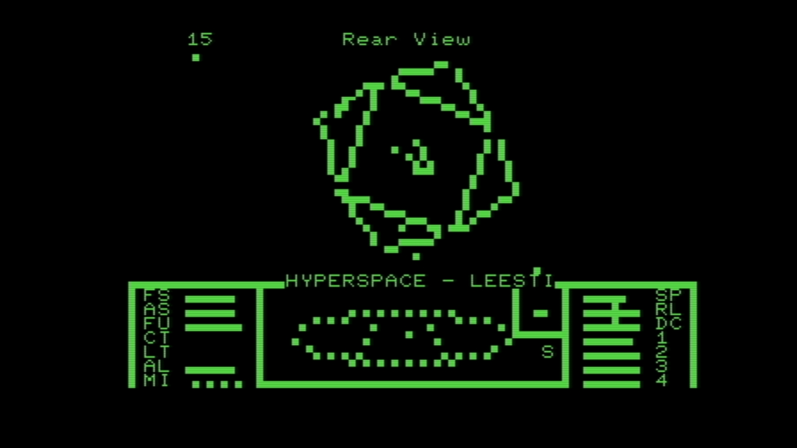

Elite for the Commodore PET
===========================

Yes!

This is a port of Mark Moxon's port of Ian Bell and David Braben's seminal 1984
game, originally for the BBC Micro. Everything should work (subject to bugs),
including limited sound support. It ought to run on any 32kB PET with a disk
system, but if you don't have a 2031 disk you'll need to make your own disk
images.

Also, [watch the video](https://www.youtube.com/watch?v=96OwwVGcTuE)!

The code is a mess. It needs some major cleaning up. It also looks and plays
like arse, due to the PET's CPU being half the speed of the BBC Micro's and the
64x35 'graphics' being slightly lower than the original's 256x192, but I think
it's still pretty good for a machine which technically can't do graphics at all!

To play:

- get [pet-elite.d64](5-compiled-game-discs/pet-elite.d64)
- put it on a 2031 disk, or load it into an emulator
- SHIFT + RUN/STOP
- enjoy!

The controls have been somewhat adapted due to the PET's weird keyboard
situation. It will work with both the graphics and business keyboards, but there
are some compromises. The key one (pun intended) is that if you have a graphics
keyboard you still have to enter numbers on the keypad.

- Flight controls:
  - Graphics: `S` `X` `,` `;`
  - Business: `S` `X` `,` `.`
- Fire: `A`
- Target missile: `T`
- Fire missile: `M`
- Untarget missile: `U`
- Activate ECM: `E`
- Jump drive: `J`
- Activate docking computer: `C`
- Cancel docking computer: `P`
- Throttle up/down: `SPACE` `?`
- Change view:
  - Graphics: `@` to `(`
  - Business: `←` to `9` (on the main keyboard)
- Disc menu (when docked):
  - Graphics: `)`
  - Business: `0`

## Important

Please don't hassle the upstream authors about this. Any bugs are strictly my
own fault. If you're interested, look at
[README.original.md](README.original.md) for the original documentation (very
little of which currently applies).

## License

None. Elite is abandonware, which means that distributing it is technically
illegal but that there isn't anyone left to care. So I'm not actually allowed to
do this. Here be dragons.

## Who

I am David Given, a.k.a. [Poking Technology](https://www.youtube.com/@hjalfi) on
Youtube. You might be interested in some of my other PET hacks, such as the
[ptracker](https://cowlark.com/ptracker/) 3½-channel music tracker. You might
like to [look at my website](https://cowlark.com). There may or may not be
anything interesting there.
